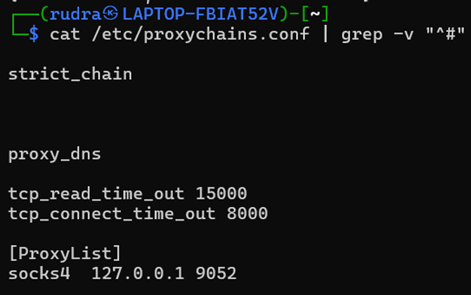
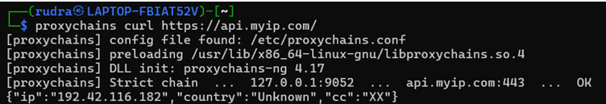
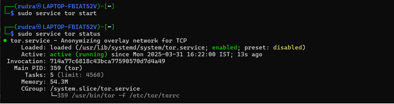
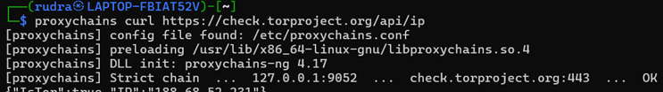
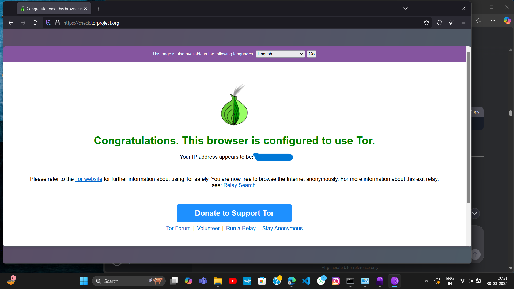

# Anonymity for Security Testing: Tor, ProxyChains & VPN

A lab exercise in configuring layered anonymity tools and verifying that traffic is routed as intended.

## Objective
Configure Tor, ProxyChains and a VPN, and understand their benefits, limits and performance cost when used in authorized security testing.

## Tools
| Tool | Purpose |
|------|---------|
| Tor (service and Browser) | Routes traffic through multiple encrypted relays |
| ProxyChains | Forces TCP connections from CLI tools through a proxy chain |
| VPN | Encrypts traffic and tunnels it through a remote server |
| Kali Linux | Platform for configuration and testing |

## Architecture
```
User -> VPN tunnel -> ProxyChains -> Tor network -> Target
```

## Setup Summary
1. **Install:** `sudo apt update && sudo apt install tor proxychains`
2. **Configure ProxyChains:** edit `/etc/proxychains.conf`, enable `dynamic_chain`, and add the Tor SOCKS proxy to the proxy list (Tor's default SOCKS port is 9050; use the port your Tor service actually listens on).
3. **Start Tor:** `sudo service tor start`
4. **Verify:**
   ```bash
   proxychains curl https://check.torproject.org/api/ip
   ```
   The response confirms whether the traffic exits through Tor.

## Results
- Tor, ProxyChains and VPN configured successfully.
- Verified the exit IP differs from the real IP.
- Observed noticeably higher latency and lower speed with multiple layers.

## Key Learnings
- Layering improves privacy but adds latency.
- Anonymity tools reduce, but do not eliminate, traceability. Misconfiguration (DNS leaks, logged-in accounts) can still expose you.
- These tools must be used within legal and authorization boundaries.

## Screenshots
## Evidence

**ProxyChains configuration**


**IP check through ProxyChains**


**Tor service running**


**Tor connection verified**


**Tor Browser**


## Disclaimer
For education and authorized testing only. Do not use to hide unauthorized activity.
